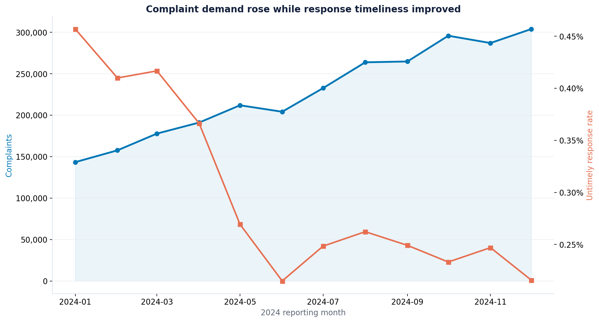
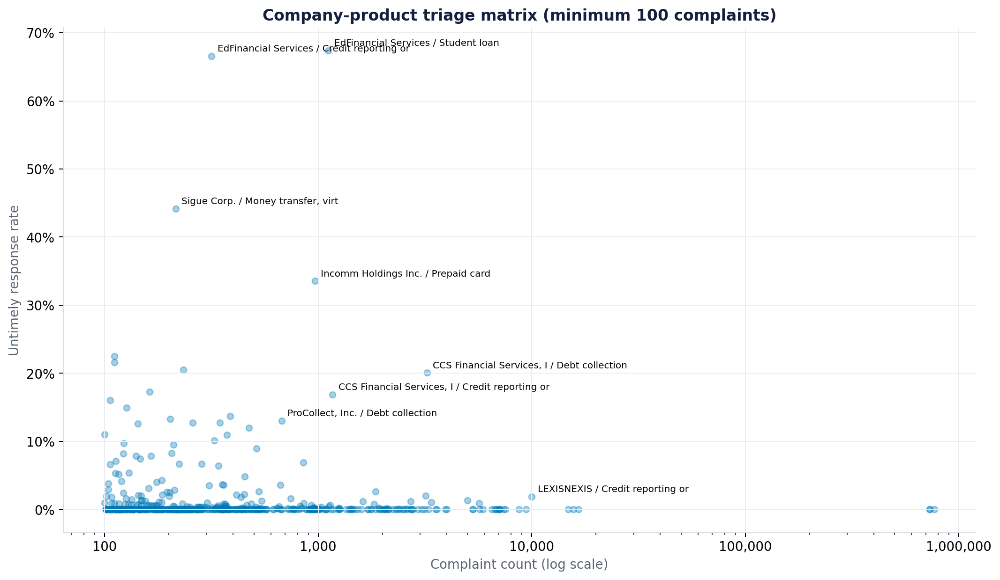

# ComplaintLens

**Consumer-finance complaint risk analytics | Python · SQL · Power BI · Data quality**

ComplaintLens is a portfolio-grade analytics project for a complaint-operations or compliance team. It turns the official CFPB Consumer Complaint Database into an operational decision system: where is response risk concentrated, which queues need attention first, and how much improvement is required to reach a selected service target?

The analysis uses **2,734,269 real complaints received in calendar year 2024**. The source snapshot was downloaded on 2026-09-27; raw data is not committed because the compressed public file is about 348 MB.

## Decision supported

Prioritize product, issue, and company-product queues using both workload and response timeliness. Volume is treated as workload—not as proof of poor performance—because CFPB complaints are not a statistical sample and company market exposure is unavailable.

## Executive findings

| KPI | 2024 result | Operating interpretation |
|---|---:|---|
| Complaints | 2,734,269 | Large and rising workload |
| Timely response rate | 99.72% | Strong portfolio average; use segment views to find exceptions |
| Untimely responses | 7,737 | Actionable exception queue |
| Dec vs Jan volume | +112.0% | Capacity planning matters even while service improved |
| Largest product | Credit reporting: 2,365,586 | 86.5% of volume; workload concentration is extreme |
| Highest-risk sizable company-product queue | EdFinancial Services / Student loan | 751 untimely responses; 32.6% timely |

The highest untimely issue queues were debt-not-owed collection attempts (1,154), incorrect credit-report information (880), improper use of a credit report (686), and student-loan lender/servicer problems (681). These are prioritization signals, not causal conclusions.





## What makes this company-ready

- Official public data with a fixed reporting window and documented snapshot date
- Chunked ETL that scans a 5.4 GB uncompressed source without loading it all into memory
- Dimensional Power BI model with reusable DAX and a target-rate What-If parameter
- Explicit grain, KPI contracts, reconciliation checks, missingness checks, and CI tests
- Business Requirements Document, methodology, limitations, data dictionary, SQL analysis, and interview guide
- Compact processed marts (about 2.4 MB) that open immediately after cloning
- No simulated data and no hosted website

## Repository map

```text
ComplaintLens/
├── data/processed/          # Versioned, Power BI-ready analytical marts
├── docs/                    # BRD, methodology, dictionary, findings, interview guide
├── notebooks/               # Reproducible analytical walkthrough
├── powerbi/                 # Model, DAX, Power Query, theme, dashboard specification
├── reports/figures/         # Generated charts
├── sql/                     # KPI and prioritization queries
├── src/                     # Download, transform, validate, and chart code
├── tests/                   # Unit tests
└── .github/workflows/       # CI quality gate
```

## Run it

Processed marts are already included. To validate and recreate figures:

```bash
python -m pip install -r requirements.txt
python src/validate_data.py
python src/create_figures.py
python -m unittest discover -s tests -v
```

To rebuild from the live CFPB bulk download:

```bash
python src/run_pipeline.py
```

On Windows, double-click `run_project.bat` or run it from Command Prompt. The raw file is downloaded into `data/raw/` and remains ignored by Git.

## Power BI

Import the CSVs in `data/processed/`, apply the relationships in [`powerbi/DATA_MODEL.md`](powerbi/DATA_MODEL.md), paste the measures from [`powerbi/DAX_MEASURES.md`](powerbi/DAX_MEASURES.md), and follow the three-page build specification in [`powerbi/DASHBOARD_SPEC.md`](powerbi/DASHBOARD_SPEC.md). The design includes an adjustable **Target Timely Rate** parameter (98.0%–100.0%) that calculates the response improvement gap for any filter context.

## Data source and responsible interpretation

- [CFPB Consumer Complaint Database](https://www.consumerfinance.gov/data-research/consumer-complaints/)
- [Official bulk CSV download](https://files.consumerfinance.gov/ccdb/complaints.csv.zip)
- [CFPB API and field documentation](https://cfpb.github.io/api/ccdb/)

The CFPB warns that complaint submissions are not a representative sample. Complaint counts must not be interpreted as market-adjusted company quality rankings. This project therefore applies a 100-complaint comparison threshold, shows rates together with denominators, and does not claim causality.

## Recommended review path

1. Read [`docs/EXECUTIVE_SUMMARY.md`](docs/EXECUTIVE_SUMMARY.md).
2. Open the figures and processed marts.
3. Review the BRD, methodology, and Power BI specification.
4. Run the validation and tests.
5. Use [`docs/INTERVIEW_GUIDE.md`](docs/INTERVIEW_GUIDE.md) to present the case study.

## License

Code and documentation are released under the MIT License. CFPB data remains subject to its source terms and notices.
